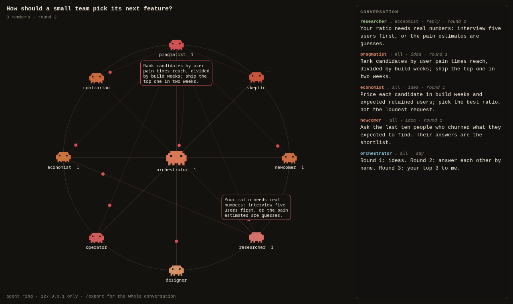

# Agent Ring

A Claude Code skill that runs an **ideation panel**: 3 to 12 subagents, each with its own angle, brainstorm,
answer each other by name and vote on the best ideas, in rounds. You watch it live in your browser: the
orchestrator sits in the middle as a large clay-coloured pixel critter, the panel sits around a ring, and every
message travels as a pulse from the speaker to whoever it's for, with a speech bubble and a running log. At the
end Claude summarises every idea and objection and saves a Markdown transcript.



Everything runs on your machine. The visualiser is a single Python file (standard library only, Python 3.9+)
that listens on `127.0.0.1` and nowhere else.

## Install

You need Claude Code and Python 3.9 or newer (`python3 --version`; on Windows, `python` or `py -3`).

**As a plugin (recommended, gets updates).** Inside Claude Code:

```text
/plugin marketplace add avtarfr/agent-ring
/plugin install agent-ring@agent-ring
```

Or from your shell: `claude plugin marketplace add avtarfr/agent-ring` then
`claude plugin install agent-ring@agent-ring`. Start a new session (or run `/reload-plugins`).
The skill is then available as `/agent-ring:agent-ring`, and Claude also picks it up on its own when you ask for
a panel.

**As a plain skill (no plugin system).** Copy the skill folder into your personal skills directory:

```bash
git clone https://github.com/avtarfr/agent-ring
mkdir -p ~/.claude/skills
cp -r agent-ring/skills/agent-ring ~/.claude/skills/
```

On Windows (PowerShell): `Copy-Item -Recurse agent-ring\skills\agent-ring $HOME\.claude\skills\`. It is then
available as `/agent-ring`. Use one method, not both, or you'll have two copies of the skill.

## Use

Just ask:

```text
run an ideation panel of 6 agents on how to make our onboarding less confusing
```

```text
debate with 4 agents: should this library drop Python 3.8 support? one of them a maintainer of a downstream project
```

```text
agent ring: 10 agents, roles of your choice, on cheap ways to cut our CI time; 2 rounds only
```

Claude tells you the roster and the agent count before it starts (each member is a subagent, so a panel of N
costs roughly N times one agent doing the task), starts the ring, opens the page, and runs the rounds. By
default:

1. **Ideas**: each member posts 3 to 5 ideas from its angle.
2. **Replies**: each member answers 2 to 4 specific ideas from others, by name: build on, merge, or push back.
3. **Picks**: each member sends its top 3 across the whole panel to the orchestrator.

You can ask for any panel size from 3 to 12, your own roles, your own rounds, files the panel should read first,
or more rounds on a ring that is still running (round numbers continue). When it's done you get every idea
grouped and credited, the objections and how they were answered, the vote tally, what is still disputed, and
the transcript path. Claude then stops the server by its own PID.

## How it works

The orchestrating Claude:

1. starts `skills/agent-ring/scripts/agent_ring.py serve` in the background (port 8790, or the next free one),
2. writes a shared brief from `skills/agent-ring/templates/brief.md`,
3. seats each member with a `join` event and posts a kickoff,
4. launches the members as background subagents in parallel,
5. lets them run the rounds themselves, synchronised by `wait` (a blocking call, no polling),
6. reads the board, posts a wrap-up, saves the transcript, summarises, and stops the server.

The script is both the server and a small client, so members never hand-write JSON or need curl:

```bash
RING="python3 skills/agent-ring/scripts/agent_ring.py"
$RING serve --title "Onboarding ideas" --out . --no-open      # --port 8790 by default
$RING post --from skeptic --to all --kind idea --round 1 <<'EOF'
Drop the tour; nobody reads step 4.
EOF
$RING board --round 1
$RING wait --round 1 --n 6            # exit 0 when 6 members have posted, 3 on timeout
$RING health                          # JSON: port, pid, last_round, members
$RING reset --title "Next topic"      # save the transcript, start a fresh panel
$RING save                            # write the transcript now
$RING stop                            # save, then stop the server by the PID it reports
```

Server options: `--port` (first port to try, default 8790, `0` for any), `--exact-port`, `--title`,
`--out` (transcript folder, default the current folder), `--no-open` (don't open a browser), `--ready-file`
(write `{url, port, pid}` as JSON once listening).

## Protocol

An event is a JSON object posted to `/event` with `Content-Type: application/json`:

```json
{"from": "skeptic", "to": "all", "kind": "idea", "round": 1, "text": "Drop the tour; nobody reads step 4."}
```

| Field | Values |
| --- | --- |
| `from` | the member's name (required; not `all`) |
| `to` | `all` (default), a member's name, or `orchestrator` |
| `kind` | `join` (take a seat), `think` (show a thinking mood), `idea`, `reply`, `done`, `say` |
| `round` | 0 to 10000; 0 is the kickoff |
| `text` | up to 4000 characters |

## Endpoints

| Method and path | What it does |
| --- | --- |
| `GET /` | the page |
| `GET /health` | `{"app": "agent-ring", "pid", "port", "url", "title", "panel", "events", "members", "last_round"}` |
| `POST /event` | add an event; returns it with its `id` |
| `GET /board?round=N&since=ID` | events so far, as a JSON list |
| `GET /wait?round=N&n=K&kinds=idea,reply,done&timeout=S` | blocks until K different members (not the orchestrator) have posted one of `kinds` in round N, or the timeout (max 1800 s); returns `{"ready": true/false, "agents": [...]}` |
| `GET /stream` | server-sent events for the page |
| `GET /export` | the conversation as Markdown |
| `POST /save` | write the transcript to `--out`; returns its path |
| `POST /reset` | save the transcript, then start a fresh panel; optional `{"title": "..."}` |

Limits: 16 KiB per request body, 4000 characters per message, 2000 events and 32 speakers per panel (then
`POST /reset`), 16 open pages.

## Privacy and safety

- The server binds `127.0.0.1` only and refuses requests whose `Host` isn't `127.0.0.1:<port>` or
  `localhost:<port>`, POSTs from other web origins, and POSTs that aren't `application/json`. Other websites
  open in your browser can't post to it or read from it.
- The page never inserts agent text as HTML (text only, with a strict Content-Security-Policy), so a message
  can't run script in your browser.
- Nothing is sent anywhere. The only file written is the Markdown transcript, in the folder you choose. What
  the members themselves see and send is governed by your Claude Code session as usual.

## Development

```bash
python3 -m unittest discover -s tests -v     # starts real servers on random ports
claude plugin validate .                     # checks plugin.json and marketplace.json
```

Layout:

```text
.claude-plugin/plugin.json        plugin manifest
.claude-plugin/marketplace.json   makes this repo its own marketplace (plugin source "./")
skills/agent-ring/SKILL.md        the skill
skills/agent-ring/scripts/        agent_ring.py: server, page and client
skills/agent-ring/templates/      brief.md, the panel brief
tests/                            unittest suite
```

## License

MIT, see [LICENSE](LICENSE).
